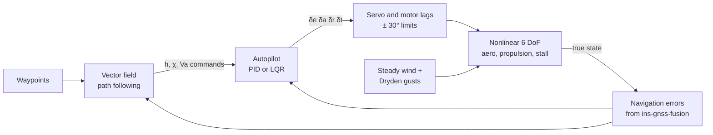
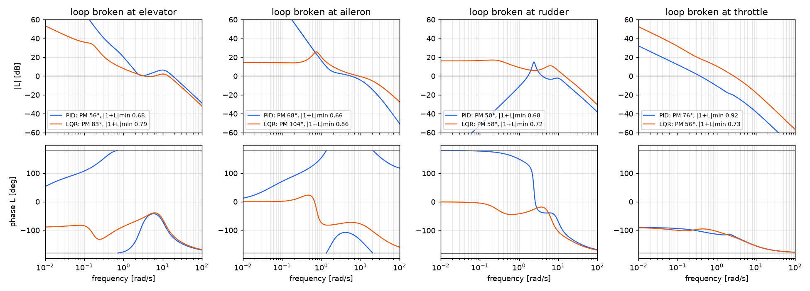
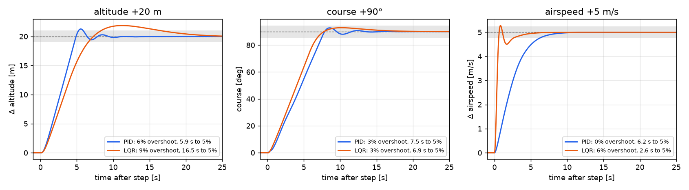
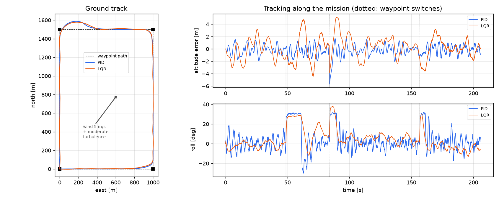
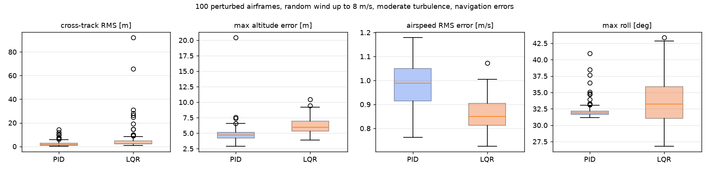

# fixed-wing-autopilot

**Flight control for a small fixed-wing UAV, from the equations of motion to a waypoint mission in turbulence.** It covers a nonlinear 6 DoF model with actuator lags, trim and numerical linearisation, modal analysis, and two autopilots on the same model: classical successive loop closure (PID) and LQR with integral action. Path following uses a vector field. Stability margins are measured at every actuator, and a 100 run Monte Carlo study covers airframe uncertainty, wind, Dryden turbulence and navigation errors.

[](https://github.com/DanielYamanoglu/fixed-wing-autopilot/actions/workflows/ci.yml)




The airframe is the Aerosonde class UAV from Beard & McLain, *Small Unmanned Aircraft* (2012): 11 kg, 2.9 m span, cruising at 25 m/s. The feedback errors are sized from the results of the companion [ins-gnss-fusion](https://github.com/DanielYamanoglu/ins-gnss-fusion) filter (0.6 m position, 0.1° roll and pitch, 0.3° heading).

## Results

### Open-loop dynamics at 25 m/s level trim

Trim: α 2.86°, elevator −7.1°, throttle 0.33. The residual is 10⁻¹⁵. Modes from the linearised model:

| Mode | Eigenvalue | ωn [rad/s] | ζ |
|---|---|---|---|
| Short period | −4.89 ± 9.87j | 11.0 | 0.44 |
| Phugoid | −0.31 ± 0.38j | 0.49 | 0.64 |
| Dutch roll | −1.55 ± 5.93j | 6.13 | **0.25** |
| Roll subsidence | −22.0 | | |
| Spiral | **+0.062** (unstable, doubles in 11 s) | | |

The lightly damped dutch roll and the slow spiral divergence are the two things the lateral autopilot has to fix. The PID gets a washed-out yaw damper for the dutch roll, and the LQR gets full lateral state feedback.

### Stability margins (loop broken at each actuator, other loops closed, servo lags included)

| Loop | PID: phase margin / delay margin | LQR: phase margin / delay margin | min \|1+L\| PID / LQR |
|---|---|---|---|
| Elevator | 56° / 54 ms | 83° / 103 ms | 0.68 / 0.79 |
| Aileron | 68° / 211 ms (gain margin 14.8 dB) | 104° / 201 ms | 0.66 / 0.86 |
| Rudder | 50° / 632 ms | 58° / 69 ms | 0.68 / 0.72 |
| Throttle | 76° / 3.6 s | 56° / 364 ms | 0.92 / 0.73 |

Every loop clears the usual 6 dB / 45° requirement. The vector margin min |1+L| ≥ 0.66 guarantees at least 38° of phase margin and −4.4 to +9.4 dB of gain margin against simultaneous changes. The smallest delay margin, 54 ms in the PID pitch loop, is still 2.7 times the 20 ms control period.



### Command tracking

| Step | PID: overshoot / settling (5%) | LQR: overshoot / settling (5%) |
|---|---|---|
| Altitude +20 m | 6% / 5.9 s | 9% / 16.5 s |
| Course +90° | 3% / 7.5 s (bank held at 30°) | 3% / 6.9 s (peak bank 27°) |
| Airspeed +5 m/s | 0% / 6.2 s | 6% / 2.6 s |



### Waypoint mission in wind and turbulence

The mission is a 5 km rectangle with a 40 m climb and a 40 m descent, flown in 5 m/s wind with moderate turbulence (σ 2.1 / 2.1 / 1.4 m/s) and navigation errors in the feedback. The cross-track figures leave out the 15 s after each waypoint switch.

| | PID | LQR |
|---|---|---|
| Cross-track RMS | **3.0 m** | 4.0 m |
| Altitude RMS / max | 0.76 m / 5.7 m | 1.5 m / 5.1 m |
| Airspeed RMS | 0.98 m/s | **0.84 m/s** |
| Peak bank | 32° | 38° |
| Control surface activity (std) | 8.0° | **3.4°** |



### Monte Carlo robustness: 100 runs per autopilot

Both autopilots fly the same 100 cases, each with the same random airframe, wind and gusts:

- **Airframe:** mass ±10%, inertias ±15%, and the stability and control derivatives (C_mα, C_mq, C_mδe, C_lp, C_lδa, C_nβ, C_nr, C_nδr, C_D) ±15–20%, all 1σ.
- **Wind:** 0 to 8 m/s from a random direction, plus moderate turbulence.
- **Feedback:** navigation errors.

The gains are designed once on the nominal model and are never retuned.

A run counts as successful only if it meets all of these:

| Criterion | Limit |
|---|---|
| Mission | completed, ending within 50 m of the last waypoint |
| Bank | under 45° |
| Altitude error | under 25 m |
| Airspeed | between 18 and 35 m/s |

| | PID | LQR |
|---|---|---|
| Successful runs | **99 / 100** | 98 / 100 |
| Cross-track RMS (mean / 95th pct) | **2.4 / 7.8 m** | 6.0 / 24.9 m |
| Max altitude error, 95th pct | **6.2 m** | 8.6 m |
| Airspeed RMS (mean) | 0.98 m/s | **0.86 m/s** |
| Peak bank, 95th pct | **35°** | 40° |
| Control surface activity (mean std) | 8.4° | **3.4°** |



### What the numbers say

- **PID tracks the path better and LQR flies smoother.** The PID inner loops are fast (pitch 15 rad/s, roll 12 rad/s), so they reject gusts and hold the path tightly, but they move the surfaces 2.5 times as much. The LQR weights trade some tracking for less actuator wear and better airspeed hold.
- **The bank limit is the real difference in path following.** Successive loop closure has an explicit roll command, saturated at 30°, which the guidance law relies on. The LQR has no such signal: its bank comes from the state feedback, bounded only by limiting the course error to 20°. In strong wind it either banks harder (up to 40°) or turns wide. The one LQR mission failure (seed 10) is exactly this: with a 7.5 m/s tailwind into the last corner it turned wide, drifted up to 185 m off the final leg and passed the last waypoint 159 m away.
- **The shared failure is a gust, not the controller.** In seed 30, a gust took airspeed to 17.0 m/s for 0.26 s, below the 18 m/s envelope, on both autopilots.
- **A real bug was found by the Monte Carlo study.** The first LQR froze all longitudinal integrators whenever *either* elevator or throttle saturated. On one airframe (31% less elevator power, 34% more pitch stiffness), the throttle saturated during climbs, the altitude integrator could never take up the new trim, and the aircraft lost 170 m. Anti-windup now freezes each integrator only on its own actuator. The case is kept as a regression test.

## How it works

- **Model** ([`dynamics.py`](src/uavctl/dynamics.py)):
  - Rigid-body equations in body axes with ZYX Euler angles.
  - Aerodynamics with a sigmoid blend to flat-plate lift past stall and a drag polar.
  - Propeller thrust that falls with airspeed.
  - First-order servo (50 ms) and motor (200 ms) lags with ±30° surface limits.
  - RK4 integration.
- **Trim and linearisation** ([`trim.py`](src/uavctl/trim.py)):
  - Least squares solver for wings level, climbing or coordinated turning flight (zero sideslip enforced).
  - Central-difference Jacobians.
  - Modal decomposition of the longitudinal and lateral blocks.
- **PID autopilot** ([`control.py`](src/uavctl/control.py)):
  - Successive loop closure: course → roll → aileron, altitude → pitch → elevator, airspeed → throttle.
  - Gains are computed from the aerodynamic transfer function coefficients for chosen natural frequencies and damping. Bandwidth separation is 9× on course and 20× on altitude.
  - Washed-out yaw damper on the rudder.
  - Conditional integration anti-windup.
- **LQR autopilot**:
  - Decoupled longitudinal (u, w, q, θ, h + ∫h, ∫Va) and lateral (v, p, r, φ, ψ + ∫χ) designs on the linearised model.
  - Weights from Bryson's rule.
  - A reference governor bounds large altitude and course errors, and integrators are held while it is active.
- **Guidance** ([`sim.py`](src/uavctl/sim.py)):
  - Straight-line vector field path following.
  - Waypoint switching on a half-plane placed one fillet distance R / tan(ρ/2) before each corner, so the turn starts where a 110 m radius arc would.
- **Wind** ([`wind.py`](src/uavctl/wind.py)): Dryden shaping filters (MIL-F-8785C), discretised exactly with Van Loan's method. A test checks that the stationary gust variance equals the specified σ².
- **Margins** ([`margins.py`](src/uavctl/margins.py)):
  - The full closed loop is linearised numerically, both autopilots included, with one actuator command broken at a time.
  - From L(jω) it computes gain, phase and delay margins at every crossover, plus the vector margin.
  - A test checks the computation against the textbook loop 1/(s(s+1)).

## Quickstart

```bash
uv sync
uv run pytest                 # 12 tests, about 5 s
uv run uavctl --runs 100      # all analyses and figures, about 45 s on 8 cores
```

Results go to [`reports/results.json`](reports/results.json) and figures to [`reports/figures/`](reports/figures/).

## Limitations

- **Simulation only.** The aerodynamic model is a published linear-derivative model with a stall blend, not wind tunnel or flight-test data, and there is no hardware in the loop.
- **Euler angles.** They are fine for this envelope, but aerobatic flight would need quaternions.
- **Continuous-time margins.** The 20 ms zero-order hold is not in the linear analysis. Its phase loss at the highest crossover (18 rad/s) is about 10°, which every loop has spare.
- **One flight condition.** Gains are designed at a single trim point (25 m/s, 100 m). A production autopilot would schedule them over airspeed and altitude.

## License

MIT
